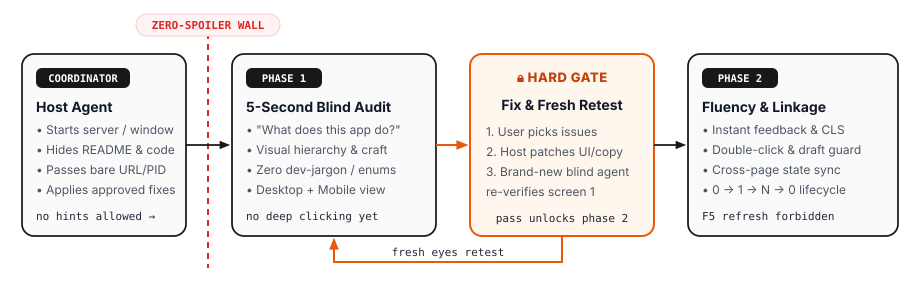

<p align="center">
  
</p>

<h1 align="center">UserSpec</h1>

<p align="center">
  <strong>Zero-Context Usability Lab for AI Coding Agents</strong><br>
  <sub>First impression first. Cross-view state linkage second. Zero source-code spoilers.</sub>
</p>

<p align="center">
  <a href="https://github.com/marksimZ/UserSpec/stargazers"></a>
  
  
  <a href="LICENSE"></a>
</p>

<p align="center">
  <strong>English</strong> &middot; <a href="README.zh-CN.md">简体中文</a> &middot; <a href="INSTALL.md">Install Guide</a>
</p>

---

**Meet Test Subject #01.** Sage sweater. Iced milk tea in one hand, your app open in the other. He isn't trying to break your product—he just tapped a link a friend sent him between errands. He pauses at your landing screen with a polite, slightly puzzled look, taps once, waits a beat when the counter doesn't move, and quietly switches back to his messages.

**UserSpec brings him into your test loop—before real users leave without filing a bug.**

---

## Why blind isolation matters

When an AI coding agent inspects a product's UX in the same session where it reads `README.md`, `package.json`, and `src/routes.tsx`, **context contamination** invalidates the test immediately. An agent that already knows the codebase understands internal acronyms, knows where secondary controls are hidden, and unconsciously forgives stale UI state.

**UserSpec** turns your coding agent into a structured usability lab: it isolates a zero-context test subject in a separate subagent, enforces a hard Stage 1 comprehension gate before allowing deep feature testing, and verifies cross-view state synchronization without manual page refreshes (`F5`).

| Dimension | Standard Code-Aware AI Review | UserSpec Blind Usability Lab |
| :--- | :--- | :--- |
| **Starting Context** | Reads `README`, routes, and component code first. | Receives **only a bare URL or desktop window PID**; zero repo access. |
| **First Impression** | Praises architecture it already understands. | Must answer 4 raw 5-second comprehension questions before scrolling or clicking. |
| **Copy & Jargon** | Accepts `TASK_PENDING`, raw ISO timestamps, and UUIDs as "working bindings." | Flags any exposed enum, internal jargon, or developer-centric error message. |
| **Test Sequencing** | Jumps straight into happy-path CRUD clicks. | **Locks Stage 2** until Stage 1 fixes are approved, patched, and verified by a **fresh** blind subagent. |
| **State Linkage** | Refreshes the page or checks the API response directly. | Bans manual `F5` reloads; verifies live sync across dashboards, badges, selectors, and Back navigation. |

---

## Usability Lab Protocol

<p align="center">
  <picture>
    <source media="(prefers-color-scheme: dark)" srcset="assets/workflow-dark.svg">
    
  </picture>
</p>

### 1. Role Quarantine (Coordinator vs. Blind Subject)
- **Host Coordinator**: Starts the local dev server or desktop application, records actual product intent internally for comparison, presents diagnostic tables to you, and applies only the fixes you approve.
- **Blind Test Subject**: Runs in an isolated subagent (`browser` for Web/H5; sandboxed `self` + native window capture for Desktop/Electron). Strictly prohibited from reading repository files.

### 2. Stage 1 — First Impression, Visual Craft & Readability
Deep CRUD clicks are prohibited during Stage 1. The subject captures Desktop (`1440×900`) and Mobile (`390×844`) viewports (or the native desktop window) and evaluates:
- **5-Second Comprehension**: *What does this software appear to do? Who is it for? What is the primary call-to-action? What creates immediate confusion?*
- **Visual Craft**: Hierarchy, alignment precision, whitespace balance, semantic color restraint, unstyled native widgets, overflow/clipping, and multi-viewport responsiveness.
- **Readability & Human Copy**: Contrast, typography scale, empty-state guidance, and strict detection of exposed developer artifacts (`null`, `undefined`, raw enums, unformatted timestamps, cryptic acronyms).
- **Login & Onboarding Walls**: Evaluates whether value is communicated *before* requesting credentials, tests guest mode or self-signup as a real newcomer, and halts cleanly (`AUTH_REQUIRED`) on CAPTCHAs, real SMS/email OTPs, mandatory OAuth, or paywalls to request a test account.

### 3. Hard Stage 1 Gate (Confirm → Patch → Fresh-Subject Retest)
The coordinator outputs a prioritized Stage 1 table (`P0 Blocker` / `P1 Major` / `P2 Minor`) with screenshot evidence and pauses for your selection. After patching approved items, UserSpec spawns a **brand-new blind subagent** (never reusing the previous session's memory) to confirm Stage 1 passes before unlocking Stage 2.

### 4. Stage 2 — Interaction Fluency & `F5`-Free Cross-View Linkage
Once Stage 1 clears, the tester navigates organically without documentation and audits:
- **Interaction Fluency**: Click affordance, async loading states and layout stability (CLS), rapid double-click duplicate-submission tests, form input preservation on validation errors, accidental backdrop-dismiss protection, and dead-end screen checks.
- **Cross-View State Linkage (Minimum 5 Chains, `F5` Forbidden)**:
  1. **CRUD → Global Summary**: Create, edit, or delete in View A → verify Dashboard cards, charts, sidebar count badges, and global search in View B update automatically.
  2. **Master-Detail & Selectors**: Rename or disable a tag/category in Settings → verify dropdown selectors and list cards elsewhere reflect the change without stale cache.
  3. **Navigation Context Persistence**: Search + filter + paginate → open Detail → click in-app Back and browser Back/Forward; verify filters, page state, and active nav highlight stay synchronized.
  4. **Global Settings Broadcast**: Switch theme, language, or user profile → inspect modals, popovers, charts, and sub-pages for visual or state drift.
  5. **Lifecycle Boundaries**: `0 items (Empty)` → `1st item` → `50+ char & special-char item` → `Delete last item back to 0`.

---

## Depth Modes & Lab Receipt

Specify an audit depth mode inline when invoking UserSpec:

| Mode | Scope | Code Edits |
| :--- | :--- | :--- |
| **`glance`** | Stage 1 rapid 5-second comprehension, visual craft, and readability screen on the entry view. | Report only |
| **`gate`** *(default)* | Full blind subagent isolation, hard Stage 1 confirmation & fresh-subject retest gate, and Stage 2 fluency + 5+ `F5`-free linkage chains. | User-approved fixes per stage |
| **`stress`** | Everything in `gate`, plus exhaustive multi-viewport/resize stress, double-submit, `0 → 1 → N → 0` overflow across linked surfaces, and simplification/removal proposals for confusing UI controls. | User-approved fixes per stage |

Every audit reply concludes with a standardized **Usability Lab Receipt** documenting test isolation, verified surfaces, and remaining risk boundaries:

```markdown
---
**UserSpec Lab Receipt** | Mode: `gate` | Gate: `STAGE 1 LOCKED`
**Isolation**: Blind subagent (0 repo files read) · **Inspected**: `/login`, `/dashboard` (`1440×900`, `390×844`) · **Pending / Risks**: Stage 2 linkage locked until P1-01 & P1-02 pass fresh-subject retest.
```

---

## Supported Surfaces

- **Web Desktop**: Built-in `browser` subagent at desktop viewports (`1440×900`) with host-verified navigation and screenshot evidence.
- **Mobile H5 / Responsive Web**: Dual-viewport checks (`1440×900` + `390×844`), horizontal overflow detection, `≥44×44px` tap-target spacing, and drawer-navigation close linkage.
- **Native Desktop / Electron / Tauri**: Sandboxed blind subagent paired with zero-dependency window capture scripts — DPI-aware Win32 DWM capture on Windows ([`capture_window.ps1`](skills/user-perspective-ux-audit/scripts/capture_window.ps1)) and macOS/Linux window capture ([`capture_window.sh`](skills/user-perspective-ux-audit/scripts/capture_window.sh)).

---

## Installation

### Antigravity
Clone the repository and reference `skills` in your project's `.agents/skills.json` (or globally in `~/.gemini/config/skills.json`):

```json
{
  "entries": [
    { "path": "/path/to/UserSpec/skills" }
  ]
}
```

### Claude Code
```text
/plugin marketplace add marksimZ/UserSpec
/plugin install userspec@userspec
```

### Codex CLI & IDE Extension
```bash
mkdir -p ~/.agents/skills && git clone https://github.com/marksimZ/UserSpec.git /tmp/UserSpec && cp -R /tmp/UserSpec/skills/user-perspective-ux-audit ~/.agents/skills/user-perspective-ux-audit
```

### Cursor, Windsurf, Cline, Copilot & Other Agents
Load [`skills/user-perspective-ux-audit/SKILL.md`](skills/user-perspective-ux-audit/SKILL.md) directly, or copy [`adapters/AGENTS.md`](adapters/AGENTS.md) into your target project. Full OS-specific instructions are available in **[INSTALL.md](INSTALL.md)**.

---

## Usage Examples

```text
Run UserSpec (gate mode) on http://localhost:5173 — audit first impression and readability first, wait for my confirmation before editing, then test cross-page linkage.
```

```text
$user-perspective-ux-audit glance
Give me a 5-second blind first-impression check on http://localhost:3000 across desktop and mobile viewports. Report only.
```

```text
$user-perspective-ux-audit stress
Audit our Electron desktop window ("QuantStudio") from a zero-context user's perspective, including window resize and multi-panel state synchronization.
```

---

## Repository Structure

```text
UserSpec/
├── assets/                                           # Editorial mascot & light/dark protocol SVGs
├── skills/
│   └── user-perspective-ux-audit/
│       ├── SKILL.md                                  # Core protocol, isolation rules, modes & prompts
│       ├── agents/openai.yaml                        # Codex / OpenAI skill display metadata
│       ├── references/
│       │   ├── phase1-first-impression-checklist.md  # Stage 1 comprehension, visual & readability rubric
│       │   ├── phase2-fluency-and-linkage-matrix.md  # Stage 2 fluency checks & 6 cross-view chains
│       │   ├── platform-adapters.md                  # Web, Mobile H5 & Native/Electron guides
│       │   └── audit-report-template.md              # Standardized Stage 1 & Stage 2 report templates
│       └── scripts/
│           ├── capture_window.ps1                    # Windows DPI-aware Win32 DWM window capture
│           └── capture_window.sh                     # macOS & Linux window capture helper
├── adapters/AGENTS.md                                # Compact ruleset for rules-only agents
├── .claude-plugin/                                   # Claude Code marketplace & plugin manifests
├── INSTALL.md                                        # Multi-agent installation guide
├── README.md                                         # English documentation (default)
├── README.zh-CN.md                                   # Simplified Chinese documentation
└── LICENSE                                           # MIT License
```

---

## FAQ

**Why separate the coordinator and the tester into two agents?**
Context contamination is irreversible within a single thread. Once an agent reads route definitions or component props to start the app, it can no longer accurately measure whether a stranger understands the interface. Keeping setup/patching in the coordinator and observation in an isolated subagent preserves a genuine zero-context baseline.

**Why require a fresh subagent after Stage 1 fixes?**
The original Stage 1 subagent already learned what the app does during the first pass. Spawning a new subagent guarantees the retest measures real first-time clarity rather than retained conversation memory.

**How does UserSpec handle authentication walls and CAPTCHAs?**
It audits the login/landing screen first, then attempts guest access or standard self-registration to evaluate onboarding friction. If it encounters a CAPTCHA, real SMS/email OTP, mandatory third-party OAuth, or payment gate, it stops immediately (`AUTH_REQUIRED`) and asks you for test credentials—it never attempts to bypass security checks.

**Does desktop capture require Python or Node dependencies on Windows?**
No. `capture_window.ps1` relies solely on built-in Windows PowerShell, .NET `System.Drawing`, `SetProcessDPIAware()`, and Win32 `DwmGetWindowAttribute` so windows at 125%–200% display scaling are captured accurately without external packages.

---

## License

Released under the [MIT License](LICENSE).
