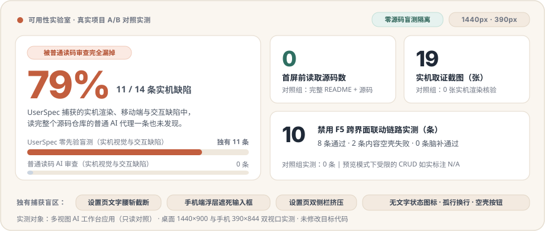
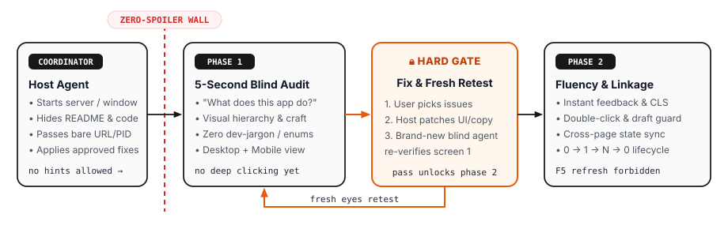
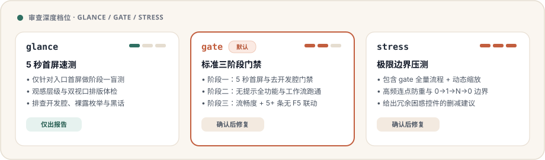

<p align="center">
  
</p>

<h1 align="center">UserSpec</h1>

<p align="center">
  <strong>面向 AI 编码代理的零先验可用性实验室</strong><br>
  <sub>先过 5 秒首屏门禁，再验无提示全功能与工作流跑通，最后测无 F5 跨界面联动。</sub>
</p>

<p align="center">
  <a href="https://github.com/marksimZ/UserSpec/stargazers"></a>
  
  
  <a href="LICENSE"></a>
</p>

<p align="center">
  <a href="README.md">English</a> &middot; <strong>简体中文</strong> &middot; <a href="INSTALL.md">安装指南</a>
</p>

---

**这是你的 01 号盲测受试者。** 穿着松软的鼠尾草绿毛衣，一手握着插着条纹吸管的冰奶茶，另一手举着刚点开你产品的屏幕。他并不是来刻意挑刺的——只是趁着日常间隙，随手点开朋友发来的链接。他在你的首屏停顿了几秒，露出礼貌又略带困惑的神情；试探着点了一下，看到数字没跟着更新，便安静地切回了聊天窗口。

**UserSpec 把这位真实的陌生用户请进了你的测试闭环——趁真正的新用户一言不发离开之前。**

---

## 为什么必须做“零源码盲测隔离”？

当普通 AI 编码代理在同一个会话里读完 `README.md`、`package.json` 和路由代码后再去审查界面时，**上下文污染（Context Contamination）** 会立刻让可用性测试失真：模型已经提前理解了内部缩写、知道隐藏功能入口的位置，也会下意识容忍需要手动刷新的状态不同步缺陷。

**UserSpec** 将你的 AI 代理组织为一套严谨的三阶段**可用性实验室（Usability Lab）**：通过独立盲测子代理实现物理隔离，先用阶段一门禁确保首屏第一印象达标，再在阶段二通过“暗建全量底账 + 两轮无提示自主通关”测出真实功能发现率与端到端工作流完通率，最后在阶段三禁用手动刷新（`F5`）系统验证跨界面状态联动。

| 审查维度 | 普通读过代码的 AI 审查 | UserSpec 零先验可用性实验室 |
| :--- | :--- | :--- |
| **初始上下文** | 先读取 `README`、路由表与组件源码。 | **仅接收裸 URL 或桌面窗口 PID**，严禁接触任何仓库文件。 |
| **第一印象评估** | 带着先入为主的架构知识给出礼貌好评。 | 在滚动或点击前，必须先凭前 5 秒直觉回答 4 项认知测试题。 |
| **文案与开发腔** | 将 `TASK_PENDING`、原始时间戳与 UUID 视作“数据绑定正常”。 | 明确标记所有外露枚举、技术术语、生硬报错与未翻译混杂文本。 |
| **功能与工作流覆盖** | 随便点两三个显眼菜单和弹窗就算测完。 | 主控暗建全量功能/工作流底账；盲测员跑 **第1轮零提示全探索 + 第2轮仅给目标补测幽灵功能**。 |
| **测试节奏控制** | 直接跳入主流程点击增删改查。 | **三阶段硬门禁依次解锁**（首屏 → 无提示全工作流 → 跨页联动），每轮修完强制**全新盲测子代理**复检。 |
| **多界面联动** | 习惯刷新页面或直接查接口返回。 | 严禁手动按 `F5`，实测跨页面统计卡片、角标、下拉选择器与返回导航的实时同步。 |

---

## 真实项目 A/B 实测数据

我们在一个真实的多视图 AI 工作台应用上执行了只读 A/B 对照实测，对比**普通读码 AI 审查**（读取项目 `README` 与前端源码）与 **UserSpec 零先验盲测实验室**（仅提供裸本地地址，零源码接触）：

<p align="center">
  <picture>
    <source media="(prefers-color-scheme: dark)" srcset="assets/field-data-zh-dark.svg">
    
  </picture>
</p>

> **核心结论**：静态读码擅长发现内部缓存与回调接线问题，而 **UserSpec 盲测捕获的 14 条实机缺陷中，有 11 条（79%）被完整读过源码的 AI 彻底漏掉**——包括设置面板展开后的说明文字横向腰斩截断、手机端快捷键浮层遮死输入框且点外不关、设置页双侧栏挤压、手机端未启动状态退化为无文字插头图标、首屏双字孤行换行以及空壳预览按钮；同时对预览模式下受限的 CRUD 持久化如实标注 `N/A`，杜绝“凭空脑补通过”。

---

## 可用性实验室工作协议

<p align="center">
  <picture>
    <source media="(prefers-color-scheme: dark)" srcset="assets/workflow-dark.svg">
    
  </picture>
</p>

### 1. 主从角色物理隔离（Coordinator vs. Blind Subject）
- **主控协调者（Coordinator）**：负责启动本地开发服务或桌面客户端、内部留存真实产品定位用于偏差对照、向你汇总分级问题清单，并严格按你的确认范围修改源码。
- **盲测受试子代理（Blind Test Subject）**：运行在独立子代理中（Web/H5 使用 `browser` 子代理，原生桌面/Electron 使用沙盒 `self` 子代理 + 窗口截图脚本），严禁读取任何项目源码与文档。

### 2. 阶段一：第一印象、观感工艺与易读性（禁止深点功能）
在点击深层业务操作前，盲测子代理截取桌面端（`1440×900`）与移动端（`390×844`）双视口（或桌面主窗口），依次评估：
- **5 秒直觉认知**：*这看起来是什么软件？面向哪类用户？最希望我第一步点击哪里？第一眼哪里让人困惑？*
- **观感工艺**：视觉主次层级、对齐精度、留白呼吸感、色彩语义克制度、原生粗糙控件、溢出截断与多端响应式适配。
- **易读性与去开发腔**：对比度与字号行高、空状态冷启动引导，严格排查 `null`、`undefined`、英文枚举、原始 ISO 时间戳与内部黑话。
- **登录墙与新用户门槛**：先评估登录页是否在索要账号前讲清产品价值；再以真实新用户身份尝试游客模式或自助注册；遇到图形验证码、真实短信/邮箱验证码、强制 OAuth 或付费墙时立即安全停机（`AUTH_REQUIRED`）向你索要测试账号。

### 3. 门禁 1（确认清单 → 修改代码 → 全新受试者复检）
主控输出分级诊断表（`P0 Blocker` / `P1 Major` / `P2 Minor`）及首屏截图证据，**暂停等待你拍板本次修改项**。代码修复完成后，必须启动一个**全新的盲测子代理**（绝不复用带有旧记忆的子代理）重新验收首屏，通过后才解锁阶段二。

### 4. 阶段二：无提示全功能自主探索与工作流完通审计
告别“点开弹窗看一眼就算测过”的表面逛街，实测真实新用户在**完全没有提示**时到底能发现多少功能、把多少业务流从头做到尾：
- **主控暗建全量底账**：开始前由主控静默扫描路由、组件、右键菜单、划词浮层、拖拽区与快捷键，列出全量功能清单（`F-01..F-N`）与端到端工作流 DoD（`W-01..W-M`），**绝不泄露给盲测员**。
- **第 1 轮（100% 纯无提示通关）**：盲测员仅凭界面引导自行制定用户目标、构造真实测试输入、穷举可见交互线索，把每条能摸到的工作流一直做到最终产出并交回《主观功能地图》。
- **双向对账与第 2 轮（仅给用户目标补测）**：主控比对算出**功能发现率（`X/N`）**与**工作流完通率（`Y/M`）**，区分 🟢 自主跑通 / 🟡 绕弯跑通 / 🟠 中途卡死 / 🔴 **幽灵功能（0% 发现）**。对漏掉的幽灵功能，第 2 轮**只告知纯用户目标、绝不说按钮在哪**，精准区分 `P1` 入口藏太深 与 `P0` 流程走不通，经你确认修复并由**全新盲测员**复检过门禁 2，才解锁阶段三。

### 5. 阶段三：交互流畅度与禁用 `F5` 的多界面联动测试
阶段一与阶段二均过关后，测试员结合全量界面系统实测：
- **交互流畅度**：点击可交互感知、异步加载与布局稳定性（CLS）、**快速连点重复提交防呆**、表单校验失败时已填内容保留、误触遮罩防丢稿，以及“死胡同界面”排查。
- **跨界面状态联动矩阵（至少实测 5 条链路，全程禁按 `F5`）**：
  1. **增删改 → 全局概览联动**：在视图 A 执行增删改 → 切到视图 B 检查首页统计卡片、图表、侧边栏数量角标与全局搜索是否自动同步。
  2. **主从详情 ↔ 关联选择器同步**：在设置页重命名/停用标签或分类 → 检查其他页面的下拉选择器与列表卡片是否无旧缓存残留。
  3. **导航流转与上下文保持**：列表搜索 + 筛选 + 翻页 → 进入详情 → 点击界面返回与浏览器前进/后退，核验筛选条件、页码与侧边栏激活高亮一致保持。
  4. **全局配置跨组件广播**：切换主题、语言或用户资料 → 核验弹窗、下拉浮层、图表与子页面全量同步且无样式撕裂。
  5. **数据生命周期边界**：`0 条空状态 → 新建第 1 条 → 50 字超长与特殊符号条目 → 全部删空回 0 条` 全链路闭合表现。

---

## 三档深度模式与验收回执栏

调用时可按需指定测试深度：

<p align="center">
  <picture>
    <source media="(prefers-color-scheme: dark)" srcset="assets/modes-zh-dark.svg">
    
  </picture>
</p>

每次审查结束均附带标准化的 **可用性实验室验收回执**，清晰记录隔离证明、已测范围与待解锁风险：

```markdown
---
**UserSpec 可用性实验室回执** | 档位：`gate` | 门禁：`阶段二锁定`
**隔离证明**：盲测子代理零源码读取 · **已测范围**：`/login`、`/dashboard`、`/knowledge`（`1440×900`、`390×844`） · **覆盖度**：`功能发现 9/12 · 工作流跑通 3/4` · **未测与风险**：阶段三跨界面联动待 `P1` 隐藏右键菜单与 `P0` 导出断流修复并通过全新盲测复检后解锁。
```

---

## 支持的软件形态

- **Web 桌面端**：通过内置 `browser` 子代理在标准桌面视口（`1440×900`）交互与截图取证。
- **移动端 H5 / 响应式网页**：桌面 + 手机双视口对比（`1440×900` + `390×844`），严查横向滚动条、`≥44×44px` 触控热区及抽屉菜单跳转联动。
- **原生桌面客户端 / Electron / Tauri**：沙盒盲测子代理配合零依赖窗口截图脚本——Windows 提供高分屏 DPI 感知 Win32 DWM 截图脚本（[`capture_window.ps1`](skills/user-perspective-ux-audit/scripts/capture_window.ps1)），macOS / Linux 提供 [`capture_window.sh`](skills/user-perspective-ux-audit/scripts/capture_window.sh)。

---

## 快速安装

### Antigravity
克隆仓库后，在目标项目的 `.agents/skills.json`（或全局 `~/.gemini/config/skills.json`）中引用 `skills` 目录：

```json
{
  "entries": [
    { "path": "/path/to/UserSpec/skills" }
  ]
}
```

### Claude Code
```text
/plugin marketplace add marksimZ/UserSpec
/plugin install userspec@userspec
```

### Codex CLI & IDE 扩展
```powershell
New-Item -ItemType Directory -Force -Path "$HOME/.agents/skills" | Out-Null
git clone https://github.com/marksimZ/UserSpec.git "$env:TEMP\UserSpec"
Copy-Item -Recurse -Force "$env:TEMP\UserSpec\skills\user-perspective-ux-audit" "$HOME/.agents/skills/user-perspective-ux-audit"
```

### Cursor、Windsurf、Cline、Copilot 等其他代理
直接加载 [`skills/user-perspective-ux-audit/SKILL.md`](skills/user-perspective-ux-audit/SKILL.md)，或将精简规则版 [`adapters/AGENTS.md`](adapters/AGENTS.md) 复制到目标项目。完整分平台安装步骤见 **[INSTALL.md](INSTALL.md)**。

---

## 调用示例

```text
用 UserSpec（gate 模式）审查 http://localhost:5173 的界面与体验：先做纯新用户第一印象体检，等我确认修改项并复检通过后，再测各界面联动。
```

```text
$user-perspective-ux-audit glance
帮我快速做一次 http://localhost:3000 的桌面端 + 手机端 5 秒首屏盲测，仅输出体检报告不改代码。
```

```text
$user-perspective-ux-audit stress
我已经打开了桌面端窗口（"QuantStudio"），按零先验用户视角做全链路流畅度、窗口缩放与多面板联动压测。
```

---

## 常见问题 (FAQ)

**为什么要把主控和盲测员拆成两个代理？**
同一对话线程内的上下文污染不可逆。只要模型为了启动项目读过路由配置或组件代码，就无法再客观衡量陌生用户的首屏理解成本。将环境启动/代码修复留在主控、界面感知隔离进独立子代理，才能保持真实的零先验基线。

**为什么阶段一改完代码后必须启用全新子代理复检？**
上一轮盲测子代理已经通过首轮观察理解了软件用途。重新拉起全新子代理才能验证修改后的界面对真正的首次访问者是否一目了然，而不是依赖对话记忆。

**为什么阶段二要拆成“纯无提示”与“仅给目标”两轮？**
第 1 轮直接漏掉某项功能时，需要区分到底是因为“入口藏得太隐蔽”，还是“用户就算明确想做也根本走不通”。第 2 轮仅告知普通用户目标（绝不提示任何按钮或菜单位置），就能把 **`P1` 可发现性缺陷**（带目标就能找到）和 **`P0` 流程阻断缺陷**（带着明确目标依然走不通）精准剥离开。

**遇到登录页和验证码如何处理？**
系统会先评估登录页本身的信息传达，再以真实新用户身份尝试游客体验或自助注册以检验转化门槛；一旦遇到图形验证码、真实短信/邮箱验证码、强制 OAuth 或付费墙，立即安全停机（`AUTH_REQUIRED`）向你索要测试账号，绝不绕过任何鉴权机制。

**Windows 桌面端截图是否需要额外安装 Python 或 Node 依赖？**
不需要。`capture_window.ps1` 直接调用 Windows 原生 PowerShell、.NET `System.Drawing`、`SetProcessDPIAware()` 与 Win32 `DwmGetWindowAttribute`，在 125%～200% 高分屏缩放下也能开箱即用。

---

## 开源协议

基于 [MIT License](LICENSE) 开源。
