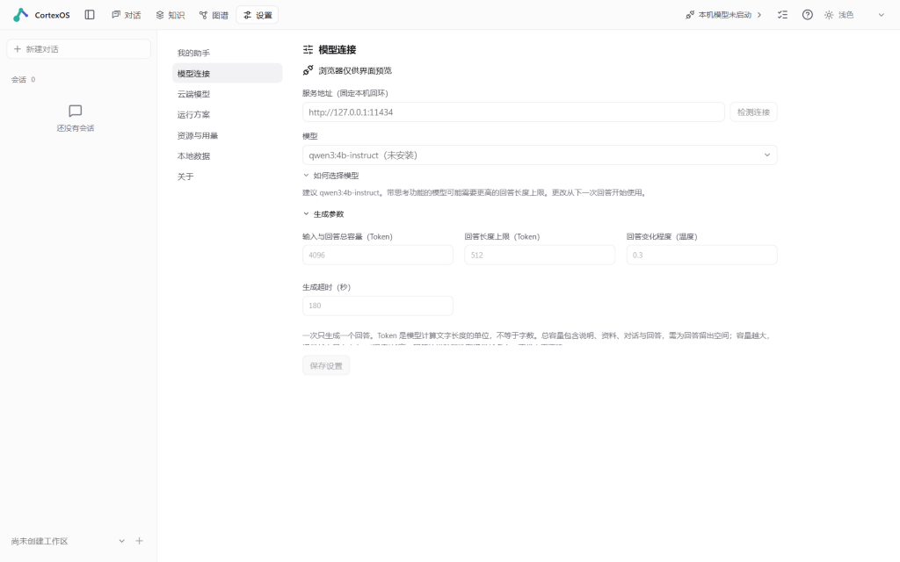
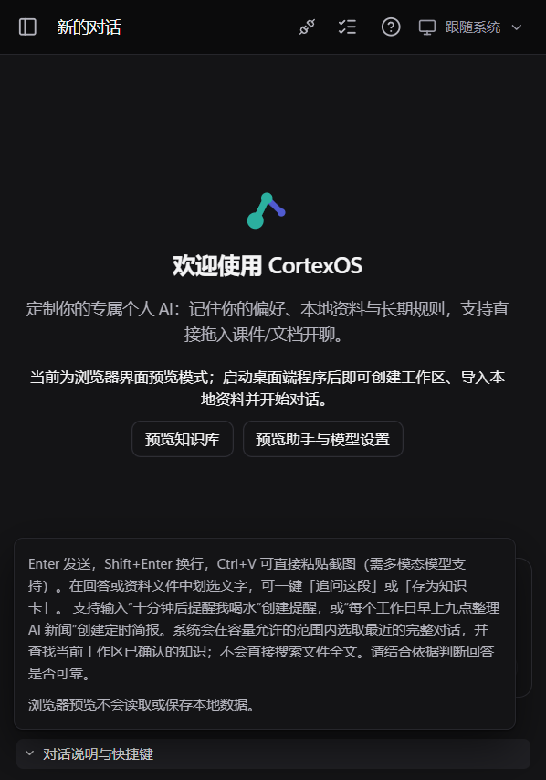
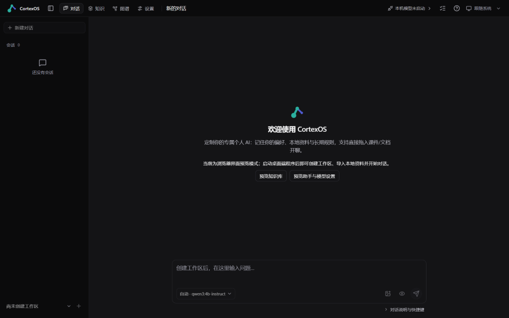

# Field Study #01 — Real-World A/B Comparison on `marksimZ/CortexOS`

- **Date:** 2026-11-26
- **Target Repository:** [`marksimZ/CortexOS`](https://github.com/marksimZ/CortexOS) (`apps/desktop`, v0.2.0, commit `201da2b`)
- **Mode:** Read-only audit (zero files modified in `CortexOS`)
- **Runtime Surface:** Local `vite preview` at `http://127.0.0.1:4175/` (browser UI preview shell, `0` console errors, `0` failed network requests)
- **Host Verification:** `BROWSER_HOST_FACTS` confirmed `visited_origins: http://127.0.0.1:4175`, `blocked_origins: none`.

---

## Experiment Design

We ran two isolated agents against the exact same repository state (`201da2b`):

1. **Arm A — Code-Aware Baseline (Without UserSpec):** A standard read-only coding assistant instructed to read `README.md` and `apps/desktop/src/` and review the UI/UX from a user's perspective.
2. **Arm B — UserSpec Blind Usability Lab (With UserSpec):** An isolated `browser` subagent given **only** the bare URL `http://127.0.0.1:4175/` (zero project name, zero README, zero source files) executing Stage 1 (5-second comprehension, visual craft, readability at `1440×900` and `390×844`) followed by Stage 2 (interaction fluency and `F5`-free cross-view linkage).

---

## Headline Comparison

| Metric | Arm A: Code-Aware Baseline | Arm B: UserSpec Blind Lab |
| :--- | :---: | :---: |
| Source files read before first impression | Full `README.md` + `apps/desktop/src/` | **0** (bare URL only) |
| Rendered screenshots inspected | 0 | **19** (`1440×900` & `390×844`) |
| Total concrete UX findings | 18 (`1 P0`, `10 P1`, `7 P2`) | **14** (`6 P1`, `8 P2`) |
| **Runtime visual / clipping / mobile defects found** | **0** | **11 (missed completely by Arm A)** |
| `F5`-free cross-view linkage flows executed | 0 (inferred statically) | **10** (`8 PASS`, `2 content-FAIL`) + `1 N/A` honestly bounded |
| Hallucinated pass on blocked preview CRUD | — | **0** (explicitly reported as blocked) |

> **Key Takeaway:** Static code review and blind usability testing catch **different defect classes**. Arm A excelled at internal state-wiring bugs (`ContextPicker` cache invalidation, missing `onResolved` callback, undefined CSS tokens). **UserSpec caught 11 live rendered, responsive, and interaction defects (79% of its findings) that reading the entire source tree missed completely.**

---

## Notable Defects Caught Exclusively by UserSpec (Missed by Code Review)

| Evidence | Severity | Surface | What Test Subject #01 Observed Live |
| :--- | :---: | :--- | :--- |
|  | **P1** | `#/settings` (`模型连接` → `生成参数`) | Expanding both accordions in Light mode **horizontally clips the second line of the helper paragraph** directly above `保存设置`. At the same time, keeping the chat sidebar open on Settings creates a **double-sidebar collision** (`会话` + `设置分类`). |
|  | **P1** | `#/chat` (`390×844`, `对话说明与快捷键`) | Opening the help popover **completely occludes the chat textarea, model selector, and send button**, and clicking elsewhere on the page or top bar fails to dismiss it. |
|  | **P1** | `#/chat` (`1440×900`) & `#/knowledge` | Both welcome CTAs (`预览知识库`, `预览助手与模型设置`) promise a preview yet lead to single-sentence empty desktop-only stubs; composer instructs `创建工作区后，在这里输入问题…` while the `+` workspace button is disabled with no tooltip. |
| *(Verified on `390×844`)* | **P1** | Topbar status (`390×844`) | `本机模型未启动 >` collapses to an unlabeled `27×15px` plug icon on mobile, leaving first-time users with no hint of what it means. |
| *(Verified on `1440×900` & `390×844`)* | **P2** | Welcome copy & Settings tabs | Orphaned 2-character wrap (`开聊。`) on desktop; mid-word split (`可创建工\n作区`) on mobile; `云端模型` tab renders mismatched heading `<h2>云端连接</h2>`; empty states align differently between `#/knowledge` (centered) and `#/graph` (top-aligned). |

---

## F5-Free Cross-View Linkage Results (Arm B)

| Linkage Flow (View A → View B, Zero Page Reloads) | Result |
| :--- | :---: |
| Theme switch (`跟随系统` → `浅色`) on Chat → Knowledge / Graph / Settings | **PASS** |
| Theme switch (`浅色` → `深色`) on Settings → Chat & Mobile Drawer | **PASS** |
| Sidebar expanded/collapsed toggle across Knowledge → Graph → Settings → Chat | **PASS** |
| Topbar status link (`本机模型未启动`) → Settings (`模型连接`) | **PASS** |
| Topbar logo (`CortexOS 首页`) on Settings → Chat | **PASS** |
| Welcome CTA (`预览知识库`) → `#/knowledge` | **Route PASS / Content FAIL** (empty stub) |
| Welcome CTA (`预览助手与模型设置`) → `#/settings?section=assistant` | **Route PASS / Content FAIL** (empty stub) |
| `使用帮助` FAQ deep link (`配置云端模型`) → closes modal & activates `#/settings?section=cloud` | **PASS** |
| Browser Back (`#/settings?section=cloud` → `#/settings`) | **PASS** |
| Mobile drawer navigation (`设置` at `390×844`) → closes drawer & switches view | **PASS** |
| Workspace / session creation & Settings save persistence | **N/A** (disabled in browser preview shell) |

---

**UserSpec Lab Receipt** | Mode: `gate` (read-only field study) | Target: `marksimZ/CortexOS@201da2b`
**Isolation**: Blind subagent (0 repo files read) · **Inspected**: `#/chat`, `#/knowledge`, `#/graph`, `#/settings`, global modals (`1440×900`, `390×844`) · **Unchecked / Scope Boundary**: Native Tauri IPC & CRUD persistence disabled in browser preview shell.
