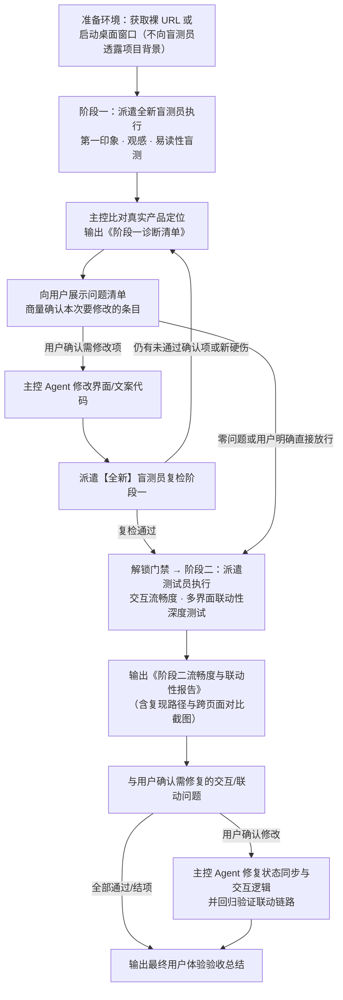

# 纯用户视角软件界面与体验审查 (User-Perspective UX Audit)

本 Skill 用于指挥模型**彻底站在“完全没见过该项目的真实新用户”角度**审查软件界面与交互体验。通过**主从角色物理隔离**消除“开发者滤镜”，并严格执行**“先过第一印象门禁、再测流畅度与跨界面联动”**的两阶段闭环工作流。

---

## 一、 零先验盲测三大铁律（最高优先级）

开发者自己测不出体验问题的根源在于**“知识的诅咒”**（提前知道项目是干嘛的、知道缩写含义、知道按钮藏在哪、习惯了怪异流程）。执行本 Skill 时必须遵守以下三条铁律：

1. **双角色物理隔离（Coordinator vs. Blind Tester）**
   - **主控 Agent（你）**：负责与用户沟通、启动被测软件/开发服务器、记录真实产品定位（仅留作内部对照）、向用户汇报问题清单、按用户确认项修改源码。
   - **盲测员子代理（Subagent）**：扮演第一次接触该软件的陌生用户。**严禁盲测员读取任何项目源码、`README.md`、配置文件、路由表、接口文档或 Git 记录**，只能通过真实画面截图与界面交互来认知软件。
2. **严禁向盲测员剧透业务背景（Zero Context Leakage）**
   - 给盲测员下发 Prompt 时，**只能提供裸入口**（如裸 URL `http://localhost:5173`，或桌面窗口标题/进程 PID）。
   - ❌ **错误示范**：“打开 `http://localhost:3000` 这个番茄钟待办管理应用，测试新建任务和统计页……”（直接剧透了软件用途和功能）。
   - ✅ **正确示范**：“你是一个偶然点开 `http://localhost:3000` 的普通新用户，你完全不知道这是什么软件。请打开它并记录你的第一直觉……”
3. **复检必须启用全新盲测员（Fresh Eyes on Retest）**
   - 第一阶段代码修复完成后，必须调用 `invoke_subagent` 启动一个**全新的盲测子代理**重新做首屏盲测，绝不能用 `send_message` 让已经看过旧版界面的同一个子代理复检“第一印象”。

---

## 二、 多平台审查路由（全平台支持）

开始前先确认被测软件形态（若用户未说明，可快速检查当前项目或询问用户），并读取 [platform-adapters.md](./references/platform-adapters.md) 获取对应平台的子代理启动方式与命令：

| 软件形态 | 执行载体 | 核心审查覆盖面 |
| :--- | :--- | :--- |
| **Web 桌面端应用** | `browser` 子代理（默认桌面视口 `1440×900`） | 首屏视觉层级、排版对齐、鼠标悬停/点击反馈、路由前进后退联动 |
| **移动端 H5 / 响应式网页** | `browser` 子代理（切换手机视口如 `390×844` 与桌面端对比） | 双端自适应布局、横向溢出排查、拇指热区与触控间距（`≥44px`）、抽屉菜单联动 |
| **原生桌面客户端 / Electron / Tauri** | 受控纯净 `self` 子代理 + [capture_window.ps1](./scripts/capture_window.ps1) 窗口截图与系统交互（若纯 Web 渲染层无原生依赖也可辅以 `browser`） | 窗口默认尺寸合理性、缩放自适应、原生弹窗/菜单协调度、跨面板状态同步 |

> **提示**：对于常规 Web 项目，在阶段一应**默认顺带切一次手机尺寸视口**检查响应式观感（除非用户明确声明这是纯宽屏后台/桌面专属工具）。

---

## 三、 登录墙与新用户门槛处理策略

盲测员打开入口后，如果首先遇到**落地页 / 登录注册墙**，严格按以下三步递进，**绝不跳过新用户上手门槛的检验**：

1. **外层第一印象审查**：登录/落地页本身就是陌生人看到的第一张脸。先审查它——*在要求用户掏出邮箱手机号注册之前，页面有没有说清楚“这是什么软件、能给我带来什么价值”？* 如果一上来只有一个冷冰冰的账号密码框且毫无产品说明，直接记为阶段一高优问题。
2. **优先尝试真实新用户自注册 / 游客体验**：
   - 先寻找页面上是否有“游客试用 / 查看示例 / 免登录体验 / 跳过”入口。
   - 若无，按普通新用户方式尝试使用明显的测试邮箱/账号走一遍**“新用户注册 → 首次进入”**完整链路，顺带审查注册表单门槛、密码规则提示、首次进入引导（Onboarding）。
   - **安全红线停机条件**：一旦遇到图形验证码（CAPTCHA）、真实手机短信/邮箱验证码、强制第三方 OAuth 登录、邀请码或付费墙，盲测员必须**立即停止并返回 `AUTH_REQUIRED`**（严禁绕过任何验证机制）。主控 Agent 随后向用户索要测试账号密码或已登录环境。
3. **内层主界面二次“第一印象”体检**：穿过登录墙首次进入软件**主工作台界面**时，那里是产品的真正核心首屏，必须同样执行完整的**阶段一：第一印象与易读性体检**，过关后才能进入阶段二。

---

## 四、 两阶段门禁式工作流（Gatekept Workflow）

整个审查严格分为两个阶段，中间设有强制门禁（Gate）：**第一印象没修好、没复检通过，绝不允许开始测功能联动。**



---

### 阶段一：第一印象、观感与易读性审查（禁止深点业务功能）

1. **阅读细则**：主控 Agent 先读取 [phase1-first-impression-checklist.md](./references/phase1-first-impression-checklist.md) 与 [audit-report-template.md](./references/audit-report-template.md)。
2. **收集内部对照基准（仅主控自己知道）**：主控可快速浏览项目 `README` 或入口了解软件真实用途（用于评判盲测员猜得对不对），但**绝对不能把这些信息写进给盲测员的 Prompt**。
3. **派遣盲测员执行阶段一**：使用下方的**【阶段一盲测员 Prompt 模板】**启动子代理：
   - **行为约束**：只允许首屏观察、上下滚动浏览、鼠标悬停查看提示、切换桌面/手机视口（Web）或若有登录墙则尝试新用户进入主界面首屏；**禁止深入点击各个业务子模块做增删改查**。
   - **核心任务**：
     1. **5 秒直觉盲猜**：不加修饰地回答“我猜这是什么软件、给谁用的、我现在第一步该点哪里、哪里让我第一眼发懵”。
     2. **观感体检（Visual Craft）**：视觉主次焦点、留白与对齐秩序、色彩克制度与对比、组件风格统一性、半成品感/廉价模板感排查、多端视口排版。
     3. **易读性体检（Readability & Copy）**：字号行高与对比度、信息密度、空状态引导、**严抓“开发腔外露”**（英文枚举、裸 ID、技术黑话、生硬报错、不明缩写）。
4. **汇报与用户拍板（严禁擅自改代码）**：
   - 将盲测员的“5 秒猜测”与软件真实定位并排对比，按 `Blocker（阻断认知）` / `Major（明显体验扣分）` / `Minor（细节打磨）` 列出问题清单并附上截图证据。
   - **停下来询问用户**：“以上是纯新用户视角的第一印象与观感问题清单，请确认哪些需要我现在修改，哪些暂不处理？”
5. **修复与全新盲测复检（闭环门禁）**：
   - 主控按用户确认的范围修改代码并确保编译/热更新正常。
   - 启动**全新的盲测子代理**重新执行阶段一核验。确认用户指定问题全部解决、无新增视觉破坏、5 秒认知清晰后，向用户宣布**阶段一门禁通过**，正式进入阶段二。

#### 阶段一盲测员 Prompt 模板（发给 Subagent 时严禁添加项目说明）

```text
你现在扮演一名完全没见过这个软件的普通真实用户，偶然打开了它。
【入口信息】：<填入裸 URL 或 桌面窗口标识>
【绝对禁令】：严禁读取工作区任何源码、README 或配置文件；严禁猜测开发者的意图为粗糙设计找借口。

请严格按以下步骤执行【阶段一：第一印象、观感与易读性盲测】：
1. 打开入口后立刻截图保存首屏画面。在滚动或点击任何按钮之前，凭前 5 秒真实直觉回答：
   - 我第一眼觉得这是个干什么用的软件？
   - 我觉得它是给哪类人用的？
   - 界面最想让我第一步点击哪里？我找这个入口费劲吗？
   - 第一眼有没有让我迷惑、信息过载或劝退的地方？
2. 若首屏是登录/注册墙：先按上述标准评价登录/落地页（是否在索要账号前讲清了产品价值？）；随后优先寻找“游客体验/试用”或用测试信息走一遍新用户注册流程进入主界面（若遇到图形验证码、真实短信/邮箱验证码、强制第三方登录或邀请码，立即停止并返回 AUTH_REQUIRED，绝不强行绕过）。首次进入主工作台后，对主工作台首屏再做一次第 1 步的截图与 5 秒直觉回答。
3. 在【不深入点击业务增删改功能】的前提下，仅在首屏上下滚动、观察排版与悬停提示（若是 Web 页面，保存桌面视口 1440×900 截图后，再切到手机视口 390×844 截图检查响应式排版），逐项挑刺：
   - 【观感】：主次层级是否分明？对齐、间距、留白是否舒服？配色是否刺眼或杂乱？有无默认丑陋控件、图标风格打架、文字截断溢出或半成品拼凑感？
   - 【易读性】：文字对比度和字号是否清晰易扫读？有没有普通用户看不懂的“开发腔/系统黑话/英文枚举/裸露ID/生硬缩写”？空数据区域有没有清晰友好的下一步引导？
4. 返回所有截图路径、你的 5 秒盲猜原话，以及带具体界面位置描述的客观问题列表。不要给客套表扬，只讲真实感受与具体毛病。
```

---

### 阶段二：交互流畅度与多界面联动性深度测试

只有阶段一复检过关（或用户明确授权进入下一阶段）后才可执行本阶段：

1. **阅读联动矩阵**：主控 Agent 读取 [phase2-fluency-and-linkage-matrix.md](./references/phase2-fluency-and-linkage-matrix.md)。
2. **制定无剧透探索任务**：根据界面上可见的核心模块，派遣测试子代理以真实用户方式探索并跑通至少 **5 条跨界面状态联动链路**（测试员同样不读源码，完全依靠界面自身的引导和反馈完成操作；如果某个核心功能在界面上根本找不到怎么用，直接记为高优交互缺陷！）。
3. **重点实测两大维度**：
   - **流畅度（Fluency）**：点击即时反馈、异步加载过渡（有无白屏闪烁/布局跳动/卡死无提示）、快速连点防重、表单校验提示与输入保留、返回路径完整性（有无“进得去退不出来”的死胡同、误触遮罩丢草稿）。
   - **多界面联动性（Cross-View Linkage）**：
     - **跨页面数据同步（严禁手动 F5 刷新作弊）**：在 A 视图/弹窗新增、编辑、改状态或删除数据后，通过软件内导航切到 B 视图（首页统计卡片、图表、侧边栏数字角标、全局搜索、其他页面的关联下拉选择器），验证数据是否**自动实时同步**。
     - **导航与上下文保持**：列表筛选/搜索/翻页 → 进入详情页 → 点击返回（及浏览器前进/后退），检查筛选条件、页码、侧边栏高亮、面包屑和窗口标题是否准确联动。
     - **全局状态跨组件传播**：切换深浅色主题、语言、个人资料或全局开关后，打开子页面、弹窗、下拉菜单、空状态和图表，检查是否全量同步、有无局部样式撕裂。
     - **数据生命周期边界切换**：`空状态(0条) → 新建第1条 → 多条/超长文本/特殊字符 → 全部删空回0条`，检查各关联界面的状态切换是否自然闭合。
4. **阶段二汇报与修复闭环**：
   - 按 [audit-report-template.md](./references/audit-report-template.md) 输出《阶段二：流畅度与多界面联动性测试报告》，每条联动缺陷必须写明**操作界面 A → 观察界面 B → 预期联动结果 vs. 实际表现**及截图证据。
   - 询问用户确认需要修复的问题条目 → 主控修改代码 → 派遣子代理按原复现路径回归测试，直至所有确认的联动与流畅度问题闭环。

---

## 五、 审查质量核验清单（主控自检）

在向用户交付任何阶段的报告前，主控必须逐条核验：
- [ ] **盲测纯粹性**：子代理是否真的没有读取任何仓库文件？报告中引用的网站/截图是否与系统 `BROWSER_HOST_FACTS` 或真实窗口截图文件一致？
- [ ] **拒绝空洞套话**：问题是否具体到了某个按钮、某句文案、某个像素对齐或某两个页面之间的具体状态不同步？（禁止出现“整体布局还需优化”这类正确的废话）。
- [ ] **门禁纪律**：是否在阶段一未解决前抢跑测试了阶段二？是否在用户未确认清单前擅自改动了业务代码？
